<p align="center">
  
</p>

# Goldenhour

**Crypto theft response, from the signer to the last hop.** Goldenhour guards the signing service,
detects a drain while it happens, measures the freeze window, follows the stolen money across
chains in real time, and lets exchanges and payment companies screen deposits against it without
revealing what they screen.

It is built on, and running on, the largest crypto theft on record: about $6.4 billion taken from
Binance on 29 October 2026, which the FBI attributes to North Korea's TraderTraitor group.

**[See it live](https://dharmeshdev1.github.io/goldenhour/)** · [The case, read from the chain](docs/case-binance-2026-10.md) · [Method](docs/method.md) ·
[Guard](docs/guard.md) · [API](docs/api.md) · [Self-hosting](docs/self-hosting.md) ·
[Architecture](docs/architecture.md)

<!-- NUMBERS -->
**The Binance case, from chain data, as of 2026-11-10** (the [live site](https://dharmeshdev1.github.io/goldenhour/) updates every five minutes):

| | |
| --- | --- |
| Stolen, verified on-chain | $6.29 billion of the $6.43 billion reported, in 262 transfers from 11 Binance wallets |
| Frozen by issuers, read from their contracts | $2.58 billion |
| Still held at trail addresses | $2.97 billion across 984 addresses |
| Moved out to services | $568 million |
| Stablecoins swapped out of reach before a freeze | $729 million |
| First freeze | minute 56 (Tether freezes the first trail address on Ethereum) |
| Trail | 1,236 addresses on 5 chains, 57,588 transfers followed |
<!-- /NUMBERS -->

## What it does

**Guard: refuse the signature.** A policy co-signer in front of a custody signing service. It
decodes what a request would actually do and refuses what no policy allows: EIP-7702 delegations
of custody wallets, Safe transactions that delegatecall, approvals to unknown spenders, transfers
with no matching withdrawal intent. Every decision is signed into a tamper-evident log. Replayed on
the real attack transaction (50 delegations of Binance 14 for 50 consecutive nonces), it refuses
all 50.

**Watch: notice the drain.** Rules that read a custody wallet's outflows as they happen. The
strongest needs no threshold: an ordinary account cannot move value from inside contract code
unless it is running delegated code, so the first such transfer means a delegation is live. Each
wallet's other thresholds are calibrated on its own history and tested on days the calibration
never saw.

**Respond: measure the window.** Minute by minute from the first stolen transfer: how much had
left, how much was still in stablecoins an issuer could freeze, and how much escaped before the
freezes landed. It turns "respond faster" into a number of dollars per minute.

**Trace: follow the money.** One rule, stated in one line: an address joins the trail when most of
the value it ever received came from the trail. Services stop the walk, bitcoin transactions are
nodes, and cross-chain hops are followed only where the protocol itself publishes both legs
(THORChain, Relay). It re-reads only the addresses that moved, every five minutes.

**Screen: check an address privately.** Exchanges and fintechs check a deposit against the trail by
fetching one of 4,096 shards named by a hash prefix. The host never learns which address was
checked.

## Run it

```sh
uv sync --extra ml
uv run goldenhour screen 0x8532FA14ACAf483729C449b8458aedDb900543D4   # check an address
uv run goldenhour guard check examples/delegation.json --policy policies/demo.yaml   # denied, exit 4
uv run goldenhour trace --budget 600                                  # follow the money yourself
uv run goldenhour serve                                               # API, alerts, live stream
```

Self-hosted with PostgreSQL and alerts to Slack, Teams, Discord, PagerDuty or signed webhooks:
`docker compose -f deploy/compose.yaml up -d`. Kubernetes: [Helm chart](deploy/helm/goldenhour).
For agents: `goldenhour mcp` serves screening over the Model Context Protocol.

## How it is built

- **Python 3.12** package: async adapters for Ethereum and EVM chains (Routescan, Blockscout),
  Bitcoin (Esplora), Tron, the XRP Ledger, Solana, THORChain and Relay, all producing one
  normalized transfer type; SQLite or PostgreSQL through SQLAlchemy; scikit-learn for the learned
  detector; FastAPI for the server.
- **Web app:** Next.js 16, React 19, TypeScript, Tailwind, motion and GSAP, a WebGL trail graph and
  DuckDB in the browser for SQL over the published Parquet.
- **Runs itself on GitHub Actions** every five minutes, with a signed daily snapshot of the trail.
  Every third-party action and base image is pinned, the jobs that run third-party code cannot
  deploy or sign, and every build that reaches the site carries a build provenance attestation the
  pipeline verifies, down to the workflow that signed it. The breach began with a tampered package;
  this pipeline does not take that risk.

## Limits

Read [What Goldenhour cannot see](docs/method.md#what-goldenhour-cannot-see) before relying on it.
In short: it follows money, not people; it does not see inside exchanges or over-the-counter
deals; a few chains are only partly covered by free data sources; and "on the trail" is evidence
to examine, not a verdict.

## License

Apache 2.0. Chain data belongs to its public networks; the FBI's address list is public record.
