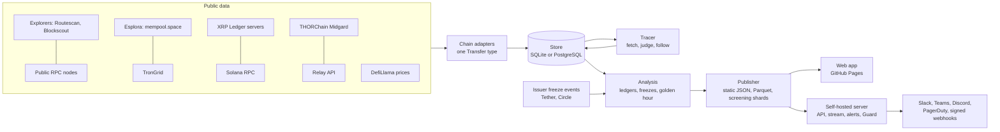

# Architecture

Goldenhour is one Python package and one web app. The package reads public blockchains, builds the
trail of stolen money, and publishes it; the web app shows it. Both run in two editions from the
same code:

- **Public edition.** GitHub Actions runs the tracer every five minutes and deploys a static site
  with a static JSON API to GitHub Pages. No server, no database server, no cost.
- **Self-hosted edition.** One container runs the tracer in the background and serves the same API
  plus what a static site cannot: direct screening, the Guard, a live event stream, alerts and
  metrics. PostgreSQL or SQLite for storage.

## The pieces

| Module | What it does |
| --- | --- |
| `models.py` | The normalized vocabulary: a node is `chain:address`, a transfer moves an amount of one asset between two nodes at one moment. Address validation lives here, so nothing unvalidated reaches storage, a file name or a URL. |
| `chains/` | One adapter per family of sources. Etherscan-style explorers (Routescan) and Blockscout's REST API for EVM chains, Esplora for Bitcoin, TronGrid, rippled for the XRP Ledger, Solana RPC, Midgard for THORChain, Relay's request index. Every adapter produces the same `Transfer`s with provider-independent ids, so any source can refresh an address another one fetched. |
| `http.py` | Every outbound request: token buckets per host, concurrency caps, `x-ratelimit-*` headers obeyed, 429s slow the host down and success speeds it back up. |
| `identify.py` | Who is behind an address: contract or wallet, public tags, category (exchange, bridge, mixer, DEX, lending, issuer). |
| `trail.py`, `tracer.py` | The trail rule and the loop that applies it: seeds, the upstream walk to first hops and victim wallets, forward judging, cross-chain links, reconsideration, and the live refresh that re-reads only addresses whose nonce or transaction count moved. |
| `freeze.py` | Issuer freezes from the issuers' own contract events. |
| `analysis.py` | Ledger balances, holdings, frozen value, exits, conversions and the golden hour curves, recomputed from scratch each run. |
| `watch.py`, `detect_eval.py` | The drain detector and its replay against the victim's own history. |
| `guard/` | The policy co-signer: decodes a signing request, applies the policy, signs a tamper-evident audit record. See [guard.md](guard.md). |
| `publish.py`, `screen.py` | The public API and the k-anonymous screening shards. |
| `server/` | The self-hosted HTTP server, its background worker and the alert channels. |
| `mcp.py` | A Model Context Protocol server so payment and compliance agents can screen addresses. |

## Why it is built this way

The decisions behind the less obvious choices are recorded as ADRs in [adr/](adr/).

- [ADR 0001](adr/0001-majority-inflow-trail-rule.md): the trail is a set of addresses chosen by a
  majority-inflow rule, not a value-level taint model.
- [ADR 0002](adr/0002-static-public-edition.md): the public edition is static files rebuilt every
  five minutes on GitHub Actions.
- [ADR 0003](adr/0003-k-anonymous-screening.md): screening fetches a 1-in-4,096 shard so the host
  never learns which address was checked.
- [ADR 0004](adr/0004-valuation-allowlist.md): only listed assets and the victim's own tokens have
  a dollar value.
- [ADR 0005](adr/0005-deterministic-cross-chain-links.md): cross-chain links come only from
  protocols that publish both legs.
- [ADR 0006](adr/0006-supply-chain.md): actions pinned by commit, artifacts attested, the bootstrap
  snapshot pinned by hash.

## Data flow of one public tick

1. Restore the trail database from the Actions cache (or a signed snapshot when the cache is cold).
2. `goldenhour trace --live`: re-read trail addresses that moved, judge new candidates, follow
   cross-chain links, reconsider counterparties. Four minutes at most.
3. `goldenhour publish`: read new freeze events, recompute everything, write the API atomically.
4. Lay the API over the signed web build and deploy to GitHub Pages.
5. If GitHub's scheduler has gone quiet, start the next run after five minutes.
